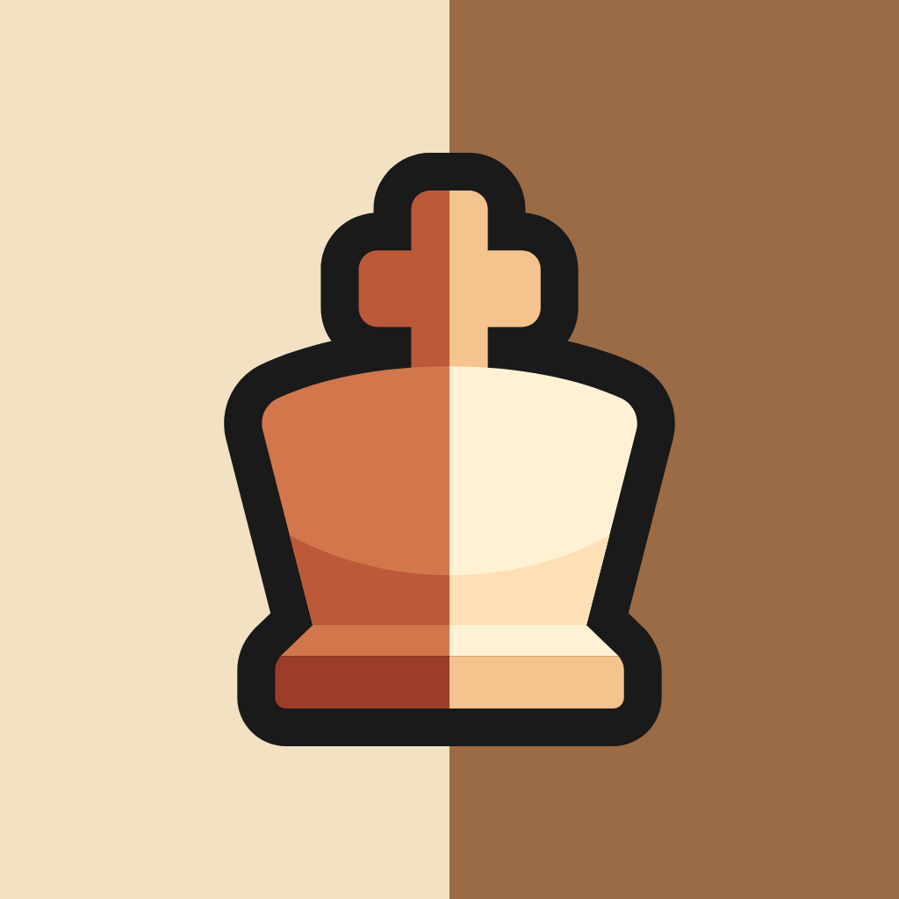
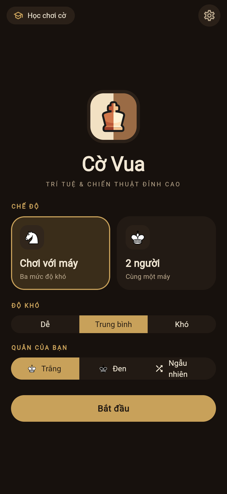
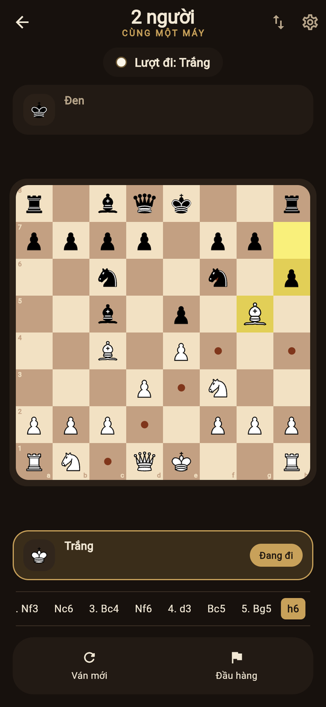
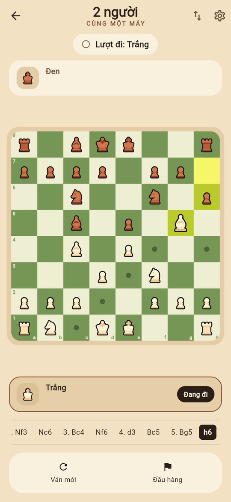
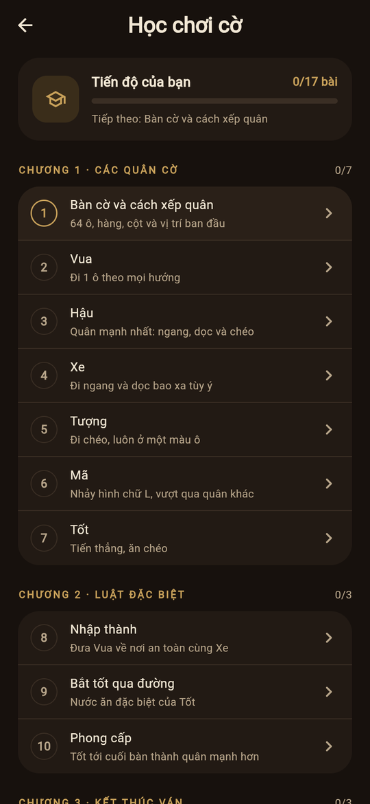
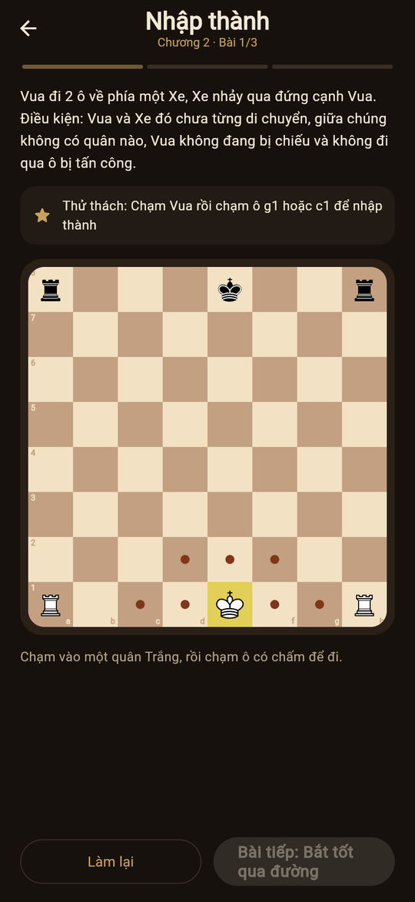
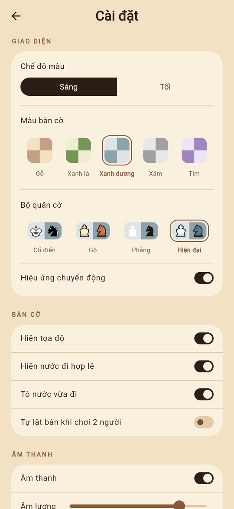

  

<h1 align="center">Cờ Vua</h1>

  <b>Trí tuệ &amp; chiến thuật đỉnh cao</b> 
  Game cờ vua cho Android: chơi với máy, chơi 2 người cùng máy, học chơi cờ từ con số 0.

  
  
  

## Chơi với máy

Thử sức với máy ở 3 mức **Dễ**, **Trung bình** và **Khó**. Bạn chọn cầm quân Trắng, Đen hoặc để app chọn
ngẫu nhiên. Máy nghĩ ngay trên điện thoại, không cần mạng.

- Đi nhầm? Bấm **Đi lại** để rút nước (có giới hạn số lần mỗi ván).
- Bí nước? Bấm **Gợi ý** để máy chỉ cho một nước đi tốt.
- Thấy hết cửa thì **Đầu hàng** và bắt đầu ván mới.
- Thoát app giữa chừng cũng không sao: ván đang chơi được lưu lại để chơi tiếp.

## Chơi 2 người

Hai người chơi chung một điện thoại. Bàn cờ có thể tự lật sau mỗi nước để người đến lượt luôn ngồi đúng
phía của mình.

## Đầy đủ luật cờ vua

- Nhập thành, bắt tốt qua đường, phong cấp (tự chọn Hậu, Xe, Tượng hoặc Mã).
- Chiếu hết, hết nước đi.
- Tự động xử hòa khi lặp lại thế cờ 3 lần, theo luật 50 nước, hoặc khi cả hai bên không đủ quân để chiếu hết.
- Danh sách nước đi theo ký hiệu cờ vua chuẩn và quân bị ăn của mỗi bên.

## Học chơi cờ

  
  

17 bài học ngắn cho người mới, chia thành các chương: cách đi từng quân, các luật đặc biệt, chiếu hết và hòa,
mẹo cơ bản. Mỗi bài có bàn cờ để chạm thử và thử thách nhỏ để kiểm tra. Tiến độ được lưu lại, học tới đâu
tiếp tục tới đó.

## Tùy biến theo ý bạn

  

- Giao diện **sáng** hoặc **tối**.
- 5 màu bàn cờ: Gỗ, Xanh lá, Xanh dương, Xám, Tím.
- 4 bộ quân: Cổ điển, Gỗ, Phẳng, Hiện đại.
- Bật/tắt tọa độ, chấm gợi ý nước đi hợp lệ, tô nước vừa đi, hiệu ứng chuyển động.
- Âm thanh (chỉnh được âm lượng) và rung.

## Nền tảng

Android. Giao diện tiếng Việt, chơi offline hoàn toàn.

---

Nguồn gốc và giấy phép của quân cờ, âm thanh, logo: [assets/LICENSES.md](assets/LICENSES.md).
